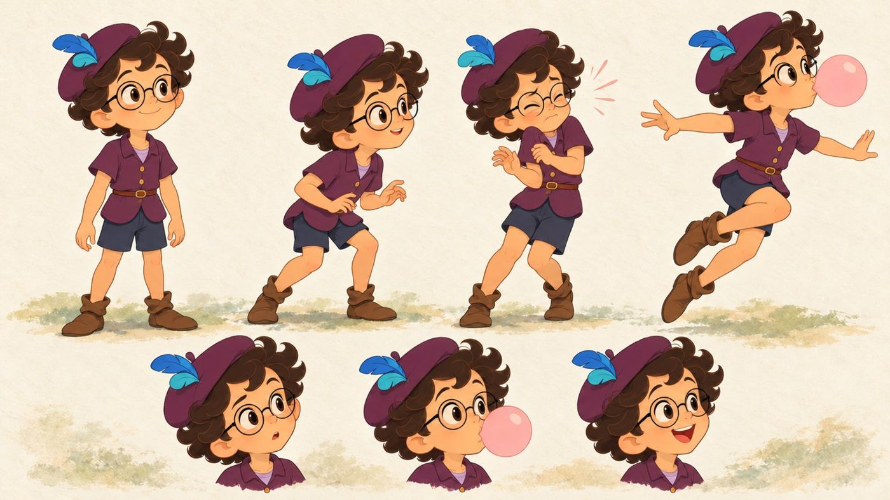
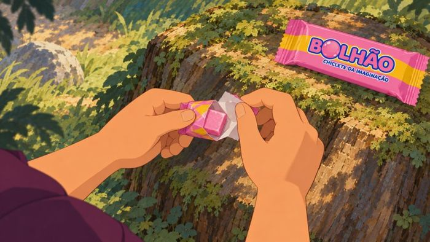

<div align="center">

# hand-drawn-2d-animation

**English** | [Português (Brasil)](README.pt-BR.md)

[](LICENSE)
[](skills/hand-drawn-2d-animation/SKILL.md)
[](skills/hand-drawn-2d-animation/SKILL.md)
[](https://agentskills.io)


</div>

> One sentence in, a 2D short that looks hand-drawn out. Story interview, character sheets, storyboard, one master prompt, **one generation** in CapCut with Seedance, QA, and a pencil animatic made with open-source tools.

## Install
Hand your agent the link:

```text
Install this skill for me: https://github.com/jonrusso/hand-drawn-2d-animation
```

Agents follow [INSTALL_FOR_AGENTS.md](INSTALL_FOR_AGENTS.md). Or install it yourself:

```bash
npx skills add jonrusso/hand-drawn-2d-animation                 # any Agent Skills client
```
```text
/plugin marketplace add jonrusso/hand-drawn-2d-animation         # Claude Code
/plugin install hand-drawn-2d-animation@hand-drawn-2d-animation
```
Manual: copy `skills/hand-drawn-2d-animation` to `~/.claude/skills/` (Claude Code) or `~/.agents/skills/` (Codex). Claude apps: zip that folder and upload it under Skills.

Then say:
> Use the hand-drawn-2d-animation skill. Interview me about my story idea, build the story bible, storyboard and master prompt, and ask before spending credits.

## Why
An AI video model is a probability machine. Most bad AI animation is not bad generation; it is a guess the model had to make because nobody decided what the hand holds, why the face changes, or what makes the cut. This skill removes those guesses in cheap steps and spends video credits once.

## How it works
```
interview ─▶ story bible ─▶ shots + storyboard ─▶ master prompt ─▶ ONE generation ─▶ QA + local repair ─▶ 1080p
  free        images          images + animatic      free, checked     video credits      repairs only
```

| | |
|---|---|
|  |  |
| **Story bible:** turnaround, hands with the story objects, faces with a cause, one identity colour | **Storyboard:** 3 to 7 shots, each with an action count, a face in order, a last frame and a cut trigger |

What the scripts check before you spend anything (`master_prompt.py check`): five fingers stated in words on every hand, a cause behind every face change, a trigger for every cut, no repeated camera setup, no broken screen direction, no words that turn drawn water into glass, no film or studio names, and the prompt length limit.

## What is inside
```
skills/hand-drawn-2d-animation/
  SKILL.md        workflow and the 12 rules that change outcomes
  references/     13 files: interview, story bible, storyboard, acting, master prompt, generation,
                  QA and repair (22 real defects), finishing, depth map, pencil animatic,
                  breakdown reel, sound, credits
  scripts/        12 local tools: prompt checker and builder, animatic, take QA, fidelity check,
                  depth map, timing chart, sketch lines, pencil animatic, breakdown reel, lettering,
                  layers, project
  assets/         templates, the BOLHAO example plan and prompt, and the v03 prompt that made the film
examples/bolhao/  the case study, with costs and every failure we hit
```

**What the example proves and what it does not.** The approved BOLHAO film came from one 30 s pass of the integral v03 prompt (`assets/examples/bolhao_v03_integral_prompt.txt`), which uses whole-second time ranges, its own continuous score and the product shot inside the generation. The 1080p master is two 15 s regenerations of that take. `bolhao_30s_plan.json` is this method applied afterwards and has not been generated yet. Both are published so you can compare.

## Support
| Area | Status |
|---|---|
| Claude Code, Claude apps | Supported |
| Codex | Supported |
| Other Agent Skills clients | Should work (standard frontmatter only), not tested |
| Seedance in CapCut (ChatGPT plugin, Codex) | Tested on the example film |
| Other video generators | The method applies; capability notes may differ |
| macOS | Tested |
| Linux | Scripts and tests run in CI |
| Windows | Not tested |

## Coming from a prompt library?
| Coming from | What's similar | What you gain |
|---|---|---|
| Seedance prompt collections | ready-to-paste prompt structure | the prompt is built from a checked shot list, so it fails before you spend, not after |
| Storyboard or shot-list skills | shots with camera and action | identity sheets, acting rules, cut triggers, take QA and a repair ladder |
| Code-driven video skills (Remotion, Manim) | an agent that ships a finished video | a generated, painterly hand-drawn look, with code only around the generation (QA, timing, animatic, reels) |

## Honest limits
- Video models follow these rules as intention, not as a contract. Watch every take.
- Prices, durations and resolutions change per provider and month. The skill tells the agent to check the connector at the time of the job.
- The pencil animatic is made after the film. It is a breakdown device, not proof of hand animation.
- The scripts do not generate images or video. Credits and accounts are yours.

## Showcase
Made something with it? [Share it](https://github.com/jonrusso/hand-drawn-2d-animation/issues/new?template=showcase.yml). Failures are as welcome as wins.

## Acknowledgements
The look of this skill was studied from the work of **Tyrus Wong**, whose painted forests defined the look of Walt Disney Animation Studios' *Bambi* (1942), and from the hand-painted backgrounds of Disney's *Snow White and the Seven Dwarfs* (1937). They are credited here because they are where this style comes from. No frames, characters or names are used in prompts, and this project is not affiliated with or endorsed by Disney. This repository contains no artwork from Tyrus Wong or Disney; its licenses cover only our own code, text and example images.

Built with CapCut, the ChatGPT plugin, Codex and Seedance, and with open source: Video Depth Anything (Small, Apache 2.0), Anime2Sketch (MIT), anime-segmentation / isnet-anime (Apache 2.0), PyTorch, ONNX Runtime, OpenCV, FFmpeg, Pillow, NumPy. See [THIRD_PARTY_NOTICES.md](THIRD_PARTY_NOTICES.md).

Made by [@russodev](https://instagram.com/russodev), with Claude Code and Codex.

## License
Code: [Apache 2.0](LICENSE). Docs, prompts and example images: [CC BY 4.0](LICENSE-docs). Example images were generated with AI tools under human direction and are licensed to the extent they are copyrightable. Output from third-party services is subject to their terms.
