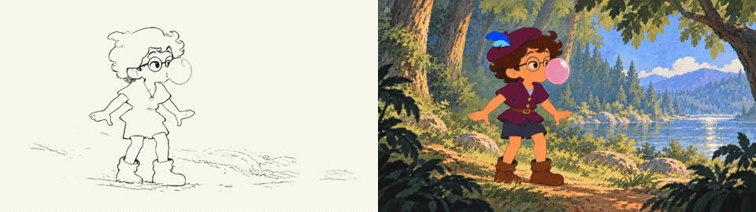

# Case study: BOLHAO (30 s, October 2026)

> A boy finds a magic bubble gum by a lake, blows a bubble that carries him over the water, falls in when it pops, and wakes up in bed to find it was a dream.

## Pipeline as it actually ran
| Step | What we did | Tools |
|---|---|---|
| Interview | one-sentence story, last frame and cut triggers decided first | ChatGPT plugin |
| Character | three tries: a realistic sheet, a storybook version in a green tunic (dropped: too close to a well-known character), a final plum costume of our own | image generation in CapCut / ChatGPT |
| Bible | forest and lake place sheet, gum pack object sheet | same |
| Storyboard | about a dozen keyframes, animatic, pose guide with a timing chart | same, plus `animatic.py`, `timing_chart.py` |
| Generation | full 30 s draft in one pass, 480p, Seedance 2.5 inside CapCut, driven by Codex through the CapCut plugin | CapCut plugin |
| Repair | a 4 s localized fix for the bubble pop | CapCut plugin |
| Finish | 1080p as two 15 s acts joined at a story beat, continuous master audio | Seedance 2 in CapCut |
| Extras | depth map, pencil animatic, 9:16 breakdown reel | Video Depth Anything, Anime2Sketch, isnet-anime, FFmpeg |

## Numbers (historical, not a price list)
- 30 s draft: 2,880 credits. 4 s repair: 384 credits.
- Depth map: 720 frames in about 2 minutes on a laptop GPU, zero credits.
- Master prompt: 3,996 of 4,000 characters, six shots.

## What failed and what we changed
| Failure | Fix |
|---|---|
| The bubble deflated instead of popping | 4 s localized repair with a fast pop and a drawn splash; the rest of the film kept |
| Feet sliding, geography changing on a bridge, a scene change mid-breath | fewer events per generation, fixed layout per place |
| Paper left on the ground, hands missing while parting leaves | written as explicit micro-actions with hand, object, verb and count |
| A 16:9 request failing repeatedly (credits returned) | one attempt with Auto ratio succeeded; record the ratio actually used |
| One black frame at the seam of the two acts | join on the shorter of video stream and container duration |
| Pencil animatic too faded, too detailed, too many drawings | simplify the shot first, extract lines, mask the character, hold drawings at 12 per second |
| Labels cut off on phones | Instagram Reels crops about 97 px each side on tall screens; keep text between x = 120 and 960 |
| A soft fade into the CTA felt weak | hard cut on the story beat (the bubble pops), extend after the cut instead |

## Files
- Plan and prompt: [`skills/hand-drawn-2d-animation/assets/examples/`](../../skills/hand-drawn-2d-animation/assets/examples/)
- Frames used in the README: [`docs/images/`](../../docs/images/)

The character, the gum brand and the story are original to this project and are offered as an example under CC BY 4.0.
